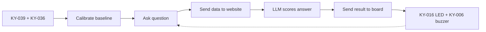

# Lie Detector - Embedded System Project

Term project for Embedded System Lab (2110366), semester 2026/1.

## Group Members

- Kantinun Sucharitkul
- Kaokanya Kokirdpanich
- Taranon Puangpetch
- Karitt Thanawan

## Overview

This project is a lie detector. It uses two sensors:

- KY-039 measures your heart rate.
- KY-036 checks that your finger is touching the sensor.

The board sends the readings to our website. The website runs an LLM (large language model, an AI that works with text, like ChatGPT) that decides if the answer is a lie. The website shows the score live. The board also shows the result with a 3-color LED and a buzzer.

## Hardware

| Component          | Module              | Role                         |
|--------------------|---------------------|------------------------------|
| Microcontroller    | STM32 NUCLEO-F411RE | Main board that runs our code |
| Heartbeat sensor   | KY-039              | Heart rate                   |
| Metal touch sensor | KY-036              | Finger contact               |
| Passive buzzer     | KY-006              | Sound output                 |
| 3-color LED        | KY-016              | Light output                 |

## Wiring

Not decided yet. See [docs/wire.md](docs/wire.md) for the wiring plan.

## Pipeline



1. Calibrate: The user rests a finger on the sensors. The board records their normal heart rate. This is called the baseline.
2. Ask: We ask a question. The board records sensor data while the user answers.
3. Analyze: The board sends the data to the website. The LLM compares it to the baseline and decides "truth" or "lie". The website shows the score.
4. Respond: The website sends the result back. The board shows it with the LED and the buzzer.

How the board connects to the website is not decided yet. One option is a NodeMCU ESP32-S3, a small board with Wi-Fi that can pass data between the STM32 and the website.

## Project Structure

```
embedded/
├── docs/
│   ├── protocol.md     messages between the board and the website
│   └── wire.md         wiring plan
├── hardware/Project/   firmware (the code that runs on the board)
│   ├── Core/           our code, starting from main.c
│   ├── Drivers/        ST's library code for the chip (do not edit)
│   └── Project.ioc     pin and peripheral settings
└── web/                website: shows the score and runs the LLM
```

Edit `Project.ioc` with STM32CubeMX, the pin setup tool built into STM32CubeIDE. After saving, it regenerates part of the code in `Core/`.

## Getting Started

### Firmware

You need STM32CubeIDE, ST's free tool to write and upload code to STM32 boards.

1. Open STM32CubeIDE. Choose the `hardware/` folder as the workspace.
2. Import the project: File > Import > Existing Projects into Workspace, then select `hardware/Project`.
3. Connect the board with a USB cable.
4. Click Run. This builds the code and flashes it (uploads it) to the board.

### Website

1. Copy `web/.env.example` to `web/.env`.
2. Put your LLM API key in `web/.env`.

The rest is TBD.
