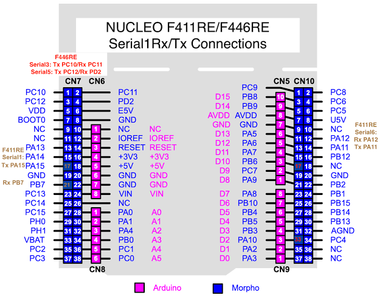

# Wiring Plan

> These pins are used by the hardware test (`Core/Src/hw_test.c`). They are not set in `Project.ioc` yet. When you set them there, use the same pins.
>
> Power the sensors from 3.3V, not 5V. The STM32 analog pins can be damaged by 5V.

## Module wiring

"Pin type needed" is the kind of board pin each module pin must connect to:

- ADC: reads an analog signal (a voltage that changes smoothly).
- GPIO in / out: reads or sets a simple on/off signal.
- PWM: switches a pin on and off very fast. The buzzer needs this to make sound.

| Module | Module pin       | Pin type needed | Board pin | Header and pin number |
|--------|------------------|-----------------|-----------|-----------------------|
| KY-039 | S (signal)       | ADC             | PA0 (A0)  | CN8 pin 1             |
| KY-039 | +                | Power           | 3.3V      | CN6 pin 4             |
| KY-039 | -                | Ground          | GND       | CN6 pin 6 or 7        |
| KY-036 | AO (analog out)  | ADC             | PA1 (A1)  | CN8 pin 2             |
| KY-036 | DO (digital out) | GPIO in         | PB5 (D4)  | CN9 pin 5             |
| KY-036 | +                | Power           | 3.3V      | CN6 pin 4             |
| KY-036 | G                | Ground          | GND       | CN6 pin 6 or 7        |
| KY-006 | S (signal)       | PWM             | PB4 (D5), TIM3_CH1 | CN9 pin 6    |
| KY-006 | -                | Ground          | GND       | CN6 pin 6 or 7, or CN5 pin 7 |
| KY-016 | R                | GPIO out        | PA8 (D7)  | CN9 pin 8             |
| KY-016 | G                | GPIO out        | PB10 (D6) | CN9 pin 7             |
| KY-016 | B                | GPIO out        | PA6 (D12) | CN5 pin 5             |
| KY-016 | -                | Ground          | GND       | CN5 pin 7             |

The labels in brackets (A0, D4, ...) are printed next to the Arduino-style headers on the board.

Both sensors need 3.3V. Use CN6 pin 4 for one and CN7 pin 16 (also 3.3V) for the other, or share one pin with a breadboard.

Pin numbers are from the Arduino-style headers (pink in the image below). For example, on CN9, pin 1 is D0 and pin 8 is D7.

## Board to website link

> **Not decided yet.** One option is a NodeMCU ESP32-S3 (a small board with Wi-Fi) connected to the STM32 by UART (a 2-wire serial connection: TX sends, RX receives).

| STM32 pin | ESP32-S3 pin | Board pin |
|-----------|--------------|-----------|
| UART TX   | RX           | TBD       |
| UART RX   | TX           | TBD       |
| GND       | GND          | GND       |

TX on one board connects to RX on the other. Both boards must share GND.

## Pins already in use

These pins are already used by the NUCLEO-F411RE. Do not connect modules to them.

| Pin       | Used for                                      |
|-----------|-----------------------------------------------|
| PA2, PA3  | USART2, sends text to the PC over the USB cable |
| PA5       | Green LED on the board (LD2)                  |
| PA13, PA14 | Debugger connection (SWD)                    |
| PB3       | Debugger output (SWO)                         |
| PC13      | Blue user button on the board                 |
| PC14, PC15 | 32 kHz clock crystal                         |
| PH0, PH1  | Main clock input                              |

Because USART2 is already used for the PC, the ESP32-S3 link needs a different UART, for example USART1 or USART6.
